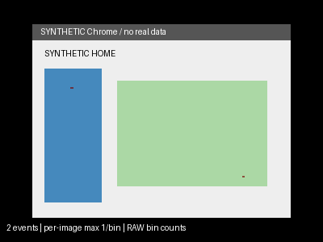
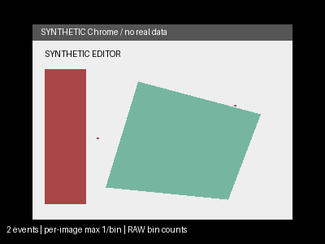
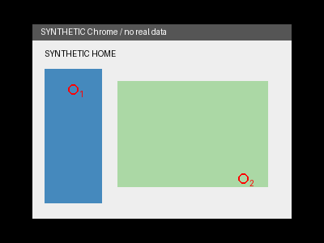
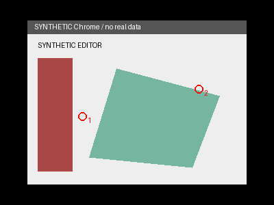

# Synthetic evidence only

`python -m examples.synthetic_demo` generates a small mock Home/Editor MKV, raw
mouse events, two annotated stable segments and real saved-frame analysis under
ignored `sessions/synthetic-demo/`. It does not access MapGen or capture anyone's
screen. FFmpeg/ffprobe must be on PATH.

The committed PNGs below were generated from that synthetic video, not participant
recordings. They demonstrate state-specific backgrounds and counted clicks, not
Windows, UIA, OBS, synchronization or Zoom accuracy.

| Synthetic Home | Synthetic Editor |
|---|---|
|  |  |
|  |  |

The full example also produces movement density, optional smoothed versions, raw
count grids, per-click actual-frame context and CSV/JSON provenance/QA. Timing
remains unverified because no independent real-world onset measurements exist.
